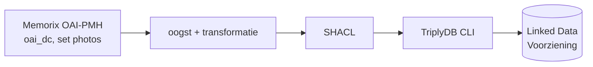

# Beeldbank RCE ETL

Haalt de beeldbank van de Rijksdienst voor het Cultureel Erfgoed (RCE) op via OAI-PMH (Memorix), zet de records om naar Linked Data
volgens **schema.org**, toetst ze met **SHACL** en publiceert ze elke week met een **GitHub Action** en de **TriplyDB-CLI** in de
Linked Data Voorziening (LDV) van de RCE. Dezelfde opzet als de [bibliotheek-ETL](../projects/bibliotheek) en de kunst-ETL.

- Beoogde dataset: `https://linkeddata.cultureelerfgoed.nl/rce/beeldbank`
- Bron: OAI-PMH van Memorix, tenant `rce`, set `photos`, formaat `oai_dc`

> **Status.** Gebouwd en getest: 74 tests slagen, en live steekproeven (1.000 foto's plus 400 uit het midden van de set) gaven geen SHACL-Violations. Een volledige run en de eerste publicatie naar Triply zijn **nog niet gedraaid**. Open besluiten
> staan in [docs/besluiten.md](docs/besluiten.md); de aanpak voor de eerste runs in [docs/beheer.md](docs/beheer.md).

## Hoe het werkt



Elke run oogst alles: de OAI meldt geen verwijderde records (`deletedRecord = no`), dus een deltaoogst zou verwijderingen missen.

| Set | Records | Wordt | Graph in Triply |
|---|---:|---|---|
| `tenant:rce:search_s_entity_type:photos` | 565.178 | `schema:Photograph` | `https://linkeddata.cultureelerfgoed.nl/rce/beeldbank/graphs/photos` |

Aantal volgens de OAI op 13 november 2026. **Alleen de foto's worden geoogst.** De andere sets van `tenant:rce` (aanwijzende tafels,
bouwtekeningen, prenten, minuutplans, verzamelplans) zijn uitgeschakeld in `config/config.yml` en in de workflow; de code, de shapes en de
tests ondersteunen ze wel, dus aanzetten kost geen nieuw werk. De tenants `gla` en `wfm` leveren geen records. Zie
[docs/besluiten.md](docs/besluiten.md).

## Wat er in de data zit

Per foto titel, beschrijving, datum, maker, rechten (`schema:license`), onderwerpen (tekst), collectie, de plaats of het adres van het
afgebeelde object (met postcode), een koppeling naar het **rijksmonument** (`Monumentnummer: N` wordt een IRI in de kennisgraaf), het
beeld (`schema:ImageObject` met bestand en miniatuur) en de link naar de beeldbank. Alle details in [docs/mapping.md](docs/mapping.md).

## Snel starten (lokaal)

Vereist Python 3.12 of nieuwer.

```bash
python -m venv .venv
source .venv/bin/activate            # Windows: .venv\Scripts\activate
pip install -r requirements.txt
```

```bash
python -m pytest
```

De sleutel van de OAI staat nooit in een bestand; zet hem in de omgeving:

```bash
export MEMORIX_OAI_KEY=<sleutel>
python src/harvest_service.py --source photos --max-records 100
```

```bash
python src/validate_service.py data/*.jsonld
```

De tweede opdracht oogst 100 foto's naar `data/`; de derde toetst ze aan de shapes.

## Kwaliteitsbewaking

Een run **faalt, en publiceert dan niets**, als:

- het aantal opgehaalde records niet gelijk is aan `completeListSize` van de bron;
- weggeschreven + fouten + overgeslagen niet gelijk is aan het aantal opgehaalde records, of een record dubbel wordt geleverd;
- records niet getransformeerd kunnen worden (standaard: geen enkel);
- een SHACL-**Violation** voorkomt. Warnings, zoals een foto zonder maker of rechtenverklaring, staan in de log maar blokkeren niet.

Records zonder enige inhoud (alleen een link zonder beeld) worden overgeslagen en met hun identifier in het manifest gezet.

## GitHub Action

`.github/workflows/harvest_beeldbank.yml` draait elke **zondag 01:00 UTC** en is ook handmatig te starten, met een testmodus die
niets publiceert. Vereist de secrets `MEMORIX_OAI_KEY` en `LDV_API_TOKEN`. Stappen: tests → oogst en SHACL →
publicatie per graph (`--mode overwrite`, daarna `merge`) → synchronisatie. **Let op:** de planning publiceert direct. Start de eerste
keer handmatig met `testmode` aan; zie [docs/beheer.md](docs/beheer.md).

## Inhoud van de repository

```
.github/workflows/harvest_beeldbank.yml   de workflow
config/config.yml                           alle instellingen
src/                                        oai_client, transform_service, harvest_service, validate_service, uris
shacl/beeldbank.shacl.ttl                   de shapes
tools/maak_fixtures.py                      maakt de testfixtures uit de live OAI
tests/                                      pytest; echte records in tests/fixtures/
docs/                                       mapping, besluiten, beheer
```

## Herkomst, licentie en contact

De opzet volgt de bibliotheek-ETL van de RCE; de OAI-client is daarvan afgeleid. **Licentie van de code:** GPL-3.0 ([LICENSE](LICENSE)),
zoals de bibliotheek- en kunst-ETL. De rechten van de beelden staan per record in `schema:license`; de licentie van de metadata als
geheel (`LICENSE_URI`) is nog niet bepaald.

**Contact:** Infodesk van de RCE, thesauri@cultureelerfgoed.nl.
